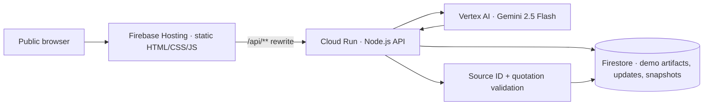

# SignalFoundry — Work Continuity Agent

**Challenge:** AI Builder Cup 2026 · Future of Work & Enterprise Productivity  
**Product:** Work Continuity Agent  
**State of this package:** Implementation and local isolated route tests complete. **Cloud deployment, live Gemini calls and Firestore integration require your Google Cloud account and are not verified in this package.**

SignalFoundry reconstructs a work handoff from multiple artifacts instead of producing another untraceable summary. It extracts operational status, decisions, tasks, blockers, dependencies and unanswered questions, and only retains claims with valid supporting source IDs and exact matching quotations. Missing evidence is marked **Unknown**.

## Architecture



- **Firebase Hosting:** deploys a zero-build browser frontend.
- **Firestore:** stores the five synthetic baseline artifacts, up to three updates per browser session, and generated snapshots. The latest snapshot is retrieved on browser reload.
- **Cloud Run:** public HTTP backend. It seeds artifacts on first access, reads/writes Firestore, calls Gemini, checks evidence, and responds to the UI.
- **Gemini:** Google Gen AI SDK using Vertex AI/Application Default Credentials; structured JSON synthesis with model `gemini-2.5-flash`.

**Trust boundary:** An exact cited quotation confirms that a source contains the quote; it does **not** independently prove that the model's paraphrased claim is semantically correct. The UI discloses this limitation. Unsupported claims are discarded, not presented as proven.

## Project structure

```text
signalfoundry-work-continuity-agent/
├── backend/
│   ├── src/
│   │   ├── ai.mjs             # Gemini model and JSON schema
│   │   ├── api.mjs            # HTTP routes and basic rate limiting
│   │   ├── core.mjs           # Evidence verification and output validation
│   │   ├── demo-data.mjs      # Five fictional artifacts
│   │   ├── server.mjs         # Cloud Run HTTP entrypoint
│   │   └── store.mjs          # Firestore persistence
│   ├── test/                 # Isolated local tests
│   ├── Dockerfile
│   └── package.json
├── frontend/
│   ├── index.html
│   ├── styles.css
│   └── app.js
├── scripts/deploy_cloud_shell.sh
├── docs/                   # Submission materials
├── .github/workflows/verify.yml  # Dependency-free contract CI
├── firebase.json
└── firestore.rules
```

## Fastest route: deploy from Google Cloud Shell

**Prerequisites:** A Google Cloud project with billing enabled; access to edit IAM, Cloud Run, Vertex AI, Firestore and Firebase; Firebase Terms accepted if requested. Cloud Run requires billing, even if usage fits in free allowances.

Follow [the exact Cloud Shell upload, authentication, deployment and live verification commands](docs/cloud_shell_deploy.md). Upload the prepared source archive through Cloud Shell's **More → Upload** control; no local Google Cloud CLI is needed.

The script checks the selected billing-enabled project and Firebase Hosting setup, enables required GCP APIs, creates the default Native Firestore database only if absent, and uses dedicated runtime and build service accounts. Runtime receives `roles/datastore.user` and `roles/aiplatform.user`; the build account receives `roles/run.builder`. It does not broaden the default compute identity. Source uploads and Docker build inputs are restricted by separate allowlists.

Deployment updates `signalfoundry-api` in `asia-south1`, makes that service publicly invocable, and publishes the default Hosting site. Existing Firestore rules are preserved unless explicitly opted in with `DEPLOY_FIRESTORE_RULES=1`; a newly created database receives the supplied deny-all client rules. No resources are deleted. Existing resources with these names must belong to this deployment.

The deployment script checks HTTP health only. Run `bash scripts/verify_live.sh` afterward for a real Gemini request, saved snapshot retrieval and an independent Firestore document read. Complete the browser checks in the command guide before claiming the workflow works.

## Endpoints

| Route | Purpose |
| --- | --- |
| `GET /api/health` | HTTP liveness; not a downstream dependency check |
| `GET /api/workspace?sessionId=UUID` | Return Firestore demo artifacts and session updates |
| `POST /api/updates` | Save optional new source `{sessionId,content}` |
| `POST /api/briefs/generate` | Call Gemini, validate citations, save snapshot `{sessionId}` |
| `GET /api/briefs/latest?sessionId=UUID` | Restore most recent saved snapshot |

## Local isolated tests

```bash
cd backend
npm test
```

Tests use dependency-injected Firestore and model *test doubles*, not a fake production path. A production deployment always requires Firestore and Gemini: **there is no fallback that silently returns synthetic AI results.**

## Security and limits

- Only fictional data is included. Do not submit confidential information.
- The browser makes same-origin calls via a Firebase Hosting `/api/**` rewrite; no API key is embedded in HTML or JavaScript.
- Vertex AI is called using the Cloud Run service account; no Gemini key is required.
- Direct Firestore web-client read/write is denied by `firestore.rules`; the Admin SDK runs on Cloud Run.
- Public anonymous demo intentionally lacks production authentication. Rate limiting is in-memory and per IP, so it is not a durable abuse-control system across instances. Cloud Run is capped at one instance in the deployment script.
- Demo update input is constrained to 12–1200 characters and three updates per session; generations are limited to six per IP in a ten-minute window.
- Anonymous browser session IDs are stored locally. Session IDs are *not* authorization; do not extend this demo to real enterprise records without authentication, tenant isolation and enforceable quotas.
- Gemini output is untrusted. Quotes are checked against exact source text, but semantic entailment and cross-source conflicts are not formally proved.

## Known limitations

No live Slack, Jira or document integrations; no enterprise authentication, authorization or tenant isolation; no asynchronous queue; no complete reasoning provenance; no human approvals; no automatic source truth determination. All source content is synthetic and clearly labeled. Evidence references verify literal quote presence, not factual correctness of claims derived from it.

## Verification checklist before submission

- [ ] Firebase URL loads without sign-in in a private window.
- [ ] `/api/health` succeeds on both Cloud Run and Firebase URLs.
- [ ] Five source artifacts appear from Firestore.
- [ ] Generate work brief invokes actual Gemini and returns structured results.
- [ ] Clicking source badges opens corresponding text with supporting quotations.
- [ ] Refreshing the page restores the saved Firestore snapshot.
- [ ] Adding an update results in six artifacts and a new generated snapshot.
- [ ] Cloud Run logs show no unexpected errors; no secrets committed.
- [ ] Public GitHub repository, prescribed-template PDF and real demo video are accessible.

The demo video should be recorded **only after** the live URL and all essential workflow checks pass.
