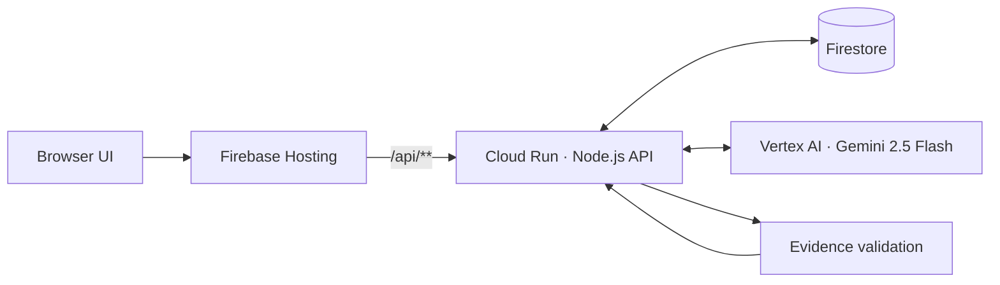

# SignalFoundry — Work Continuity Agent

**Challenge:** Google Cloud AI Builder Cup 2026 · Future of Work & Enterprise Productivity  
**Product:** Evidence-grounded work handoff reconstruction

> **Deployment status:** Local isolated route tests pass. Live Cloud Run deployment, Gemini inference, and Firestore persistence have not yet been verified.

SignalFoundry reconstructs a work handoff from multiple work artifacts instead of producing another untraceable summary. It organizes operational status, decisions, tasks, blockers, dependencies, and unanswered questions, with source references and exact supporting quotations. When evidence is missing, the brief marks the information as **Unknown**.

## How it works

1. Load the synthetic source artifacts and any updates added during the session.
2. Use Gemini to produce a structured work brief.
3. Check source IDs and cited quotations against the source text; discard claims that fail validation.
4. Save the generated snapshot so it can be restored after a browser refresh.

A matching quotation proves that the text appears in a source; it does **not** independently prove that a paraphrased claim is semantically correct. The application discloses this limitation. All included source data is fictional.

## Architecture



- **Firebase Hosting** serves the static HTML, CSS, and JavaScript frontend.
- **Cloud Run** serves the API and coordinates generation, evidence checks, and persistence.
- **Vertex AI Gemini 2.5 Flash** generates structured JSON using the Google Gen AI SDK and the service's Application Default Credentials.
- **Firestore** stores the five synthetic baseline artifacts, session updates, and generated snapshots.

## Repository structure

```text
backend/                 Node.js API, Gemini integration, Firestore store, tests
frontend/                Static browser application
scripts/                 Cloud deployment and live verification scripts
docs/                    Deployment and submission documentation
.github/workflows/       Contract-test workflow
firebase.json            Hosting configuration and API rewrite
firestore.rules          Client access rules
```

## Run the local tests

```bash
cd backend
npm test
```

The isolated tests use injected model and Firestore test doubles. Passing them does not verify live Gemini calls, cloud permissions, deployment, or Firestore integration.

## Deployment

See [`docs/cloud_shell_deploy.md`](docs/cloud_shell_deploy.md) for the Cloud Shell deployment and live-verification steps. After deployment, run `bash scripts/verify_live.sh` and complete the browser workflow checks before treating the live application as verified.

## Security and limitations

- The demo uses fictional data only. Do not enter confidential or real enterprise information.
- The demo API is publicly invocable and the application has no user authentication, authorization, or tenant isolation. Browser session IDs are not authorization credentials.
- Rate limiting is in-memory, not a durable production abuse-control mechanism.
- There are no live Slack, Jira, or document-source integrations.
- Evidence checks validate source IDs and literal quotation matches. They do not formally prove semantic entailment, resolve cross-source conflicts, or establish source truth.

This is a competition prototype, not a production-ready enterprise continuity system.
